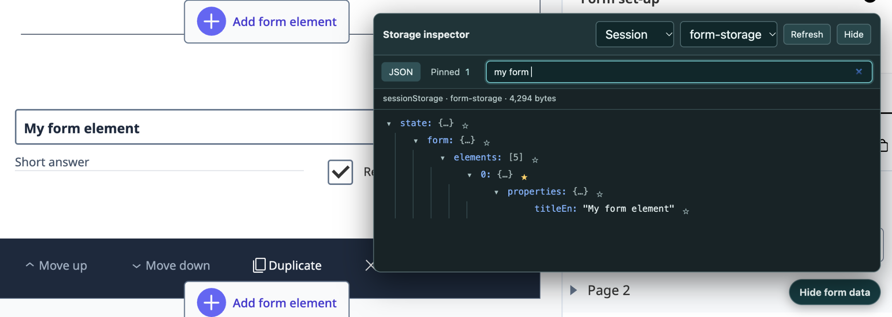

# GC Forms Storage Inspector

A small Chrome extension that adds a show/hide JSON inspector to GC Forms pages. It reads the current page's browser storage, with `sessionStorage` and the `form-storage` key selected by default. It also supports other session and local storage keys.

## Load in Chrome

1. Open `chrome://extensions`.
2. Turn on **Developer mode**.
3. Select **Load unpacked** and choose this folder.
4. Open or reload a supported form page. Select **Form data** in the lower-right corner to show the inspector.

To pick up edits to the extension, select **Reload** on its card in `chrome://extensions`, then reload the form page.

## What it shows

- Session storage, defaulting to `form-storage` when present.
- Local storage and any other keys in either storage area.
- Pretty-printed JSON, refreshed once per second while the panel is open.
- Search across JSON keys and values, with matching branches expanded.
- Pin entries to a separate **Pinned** tab. Pins persist for the page origin, storage type, and selected key; pinned values update as the stored JSON changes.
- Raw text for storage values that are not valid JSON.
- A **Copy JSON** button for the selected value.

The extension currently runs on the alpha and production GC Forms hosts, plus `localhost` and `127.0.0.1` development pages.
